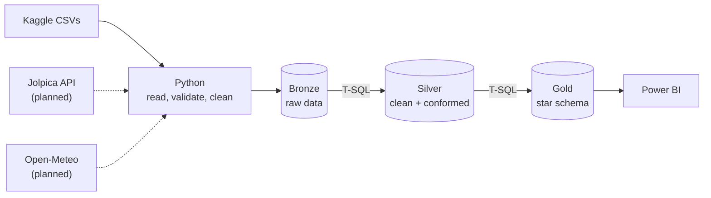

F1 Strategy Analytics
> An end-to-end data analytics project that turns 70+ years of Formula 1 data into race strategy insights: Python ingestion, a SQL Server medallion warehouse, T-SQL transformations, and a Power BI dashboard.
Status: In progress. Version 1 is intentionally simple (Kaggle CSVs, Python, SQL Server, Power BI). More data sources and automation come in later phases (see the Roadmap).
---
Table of Contents
Project Overview
Business Questions
Architecture
Tech Stack
Data Sources
Python Ingestion Layer
SQL Server Layer
Data Model
Transformation Techniques
Data Quality
Repository Structure
Getting Started
Power BI Dashboard
Roadmap
F1 Glossary
Project Management
License and Credits
---
Project Overview
The scenario: A (fictional) race strategy team has decades of race data spread across files. The head of strategy needs one trusted source to decide when to pit, how many stops to plan, and how much starting position matters.
What this project does:
Reads Formula 1 CSV files with Python, validates the records, cleans them, and loads them into SQL Server
Stores raw data, then builds cleaned tables, views and a star schema with T-SQL (medallion architecture: Bronze, Silver, Gold)
Checks the data with automated SQL quality tests
Serves the Gold layer to an interactive Power BI dashboard with DAX measures
Who it is for:
Persona	Uses
Head of strategy	Executive summary page
Race analyst	Driver, constructor and strategy drill-downs
Data engineer (me)	Data quality log, lineage and performance notes
---
Business Questions
Does pit-stop timing affect positions gained? (2011 onward, when pit-stop data exists)
What is the average time lost in the pits at each circuit?
How does grid position translate into win probability?
Are 1-, 2- or 3-stop strategies more successful, by circuit and era?
What causes DNFs, by constructor and era?
Who wins the teammate battle in qualifying and in the race?
How has constructor dominance shifted across regulation eras?
Does weather change pit-stop behavior or DNF rates? (needs weather data, added in a later phase)
---
Architecture

Solid lines are version 1. Dashed lines are planned. All three layers live in one SQL Server database (`F1StrategyDW`) as separate schemas.
Layer	Purpose	Built by	Allowed transformations
Bronze	Raw data as received, plus audit columns (`_loaded_at`, `_source_file`, `_batch_id`)	Python	Technical hygiene only (see below)
Silver	Trusted, conformed, row-level data	T-SQL stored procedures and views	Cleansing, type casting, standardization, integration, derived columns, row-level business rules
Gold	Business-ready star schema	T-SQL stored procedures and views	Aggregations, KPI logic, slowly changing dimensions
Schemas: `bronze`, `silver`, `gold`, `meta` (pipeline log, rejected rows, data quality results).
Power BI reads from Gold only.
---
Tech Stack
Tool	Role in this project
Python	Data ingestion and automation: read CSVs, validate records, clean data, load into SQL Server
SQL Server + SSMS	Store raw data, create tables and views, write advanced T-SQL, optimize queries
VS Code	Write Python and SQL scripts, organize the project, use Git
Power BI	Build the star schema model, write DAX measures, create interactive dashboards
Git + GitHub	Version control and portfolio
Cost note: Every tool above is free to use for this project (SQL Server Developer edition, SSMS, Power BI Desktop, VS Code, Python, Git). Python, Git and VS Code's core are open source. SQL Server, SSMS and Power BI are free but not open source, and SSMS and Power BI Desktop run on Windows only. Publishing and sharing Power BI reports online needs a paid license, so this repo includes screenshots, a demo video and the `.pbix` file instead.
Python libraries: `pandas`, `pyodbc`, `sqlalchemy`, `python-dotenv`, `pytest`.
---
Data Sources
Source	What it provides	Load type	Phase
Kaggle: Formula 1 World Championship (1950-2020)	About 14 CSV tables: drivers, constructors, circuits, races, results, qualifying, lap times, pit stops, status	Full	1
Jolpica-F1 API	Same structure, kept current (recent races)	Incremental	2
Open-Meteo	Weather by circuit coordinates and race date	Incremental	3
Wikipedia	Circuit facts such as length and number of turns	One-off scrape	3
Known data limits: lap times start in 1996 and pit stops in 2011, so strategy analysis focuses on 2011 onward.
---
Python Ingestion Layer
Python handles extract, validate, clean and load into Bronze.
Script	Responsibility
`config.py`	Reads connection settings from `.env`, builds the SQL Server connection
`extract.py`	Reads each CSV into a DataFrame and records the source file name
`validate.py`	Checks records and routes failures to `meta.rejected_rows` with a reason
`clean.py`	Technical hygiene before loading
`load_bronze.py`	Truncates and bulk-inserts each Bronze table; writes the run log
`run_pipeline.py`	Runs the steps in order for all tables
Validation checks
Expected columns are present and in the expected types
Primary keys are not null and not duplicated
Dates parse; numeric values are in plausible ranges
Foreign keys exist in their parent file (for example every `driverId` in results exists in drivers)
Cleaning done in Python (technical hygiene only)
Normalize column names to `snake_case`
Convert the `\N` placeholder to NULL
Trim leading and trailing whitespace
Drop exact duplicate rows
Fix encoding problems
Business cleansing (casting, standardizing, business rules) is done in SQL Server (Silver), so Bronze stays close to the source and every transformation is traceable.
---
SQL Server Layer
Naming conventions
Object	Pattern	Example
Bronze tables	`bronze.<source_table>`	`bronze.results`
Silver tables	`silver.<entity>`	`silver.pit_stops`
Gold tables	`gold.dim_*`, `gold.fct_*`, `gold.agg_*`	`gold.fct_race_results`
Stored procedures	`<schema>.usp_load_<object>`	`silver.usp_load_results`
Master procedures	`<schema>.usp_load_all`	`gold.usp_load_all`
Advanced SQL showcased
CTEs and window functions: `ROW_NUMBER`, `RANK`, `LAG`/`LEAD` (stint changes), running totals, `PERCENTILE_CONT` (outliers)
Stored procedures with error handling (`TRY...CATCH`) and run logging
Views for reusable logic (for example, `gold.vw_pit_strategy`)
`MERGE` for upserts and slowly changing dimensions
Safe casting with `TRY_CAST` and `TRY_CONVERT`
Query optimization
Indexing strategy (clustered keys, nonclustered indexes on join columns, columnstore for `lap_times`)
Execution-plan and `SET STATISTICS IO, TIME` comparisons before and after tuning
Results documented in `docs/performance_notes.md`
---
Data Model
Star schema in the `gold` schema (version 1):
Dimensions: `dim_driver`, `dim_constructor`, `dim_circuit`, `dim_race`
Facts: `fct_race_results`, `fct_pit_stops`
Aggregates: `agg_driver_season`, `agg_constructor_season`
Flags such as `is_dnf` and `is_podium` are stored as 0/1 integers so they are easy to sum in DAX. Later phases add `fct_lap_times`, `agg_circuit_strategy` and slowly changing dimension history tables.
Slowly changing dimensions
Type	Applied to
SCD 0	Circuit coordinates and country, driver date of birth
SCD 1	Spelling or nationality corrections (overwrite)
SCD 2	Driver-to-team history with `valid_from`, `valid_to`, `is_current` (Phase 3)
SCD 3	Team `current_name` and `previous_name` (Phase 3)
---
Transformation Techniques
Every technique from the ETL methods cheat sheet is implemented somewhere in the project:
Technique	Example in this project (T-SQL)	Phase
Remove duplicates	`ROW_NUMBER() OVER (PARTITION BY race_id, driver_id ORDER BY _loaded_at DESC) = 1`	1
Handling missing data	`NULLIF`, `COALESCE`; keep NULL for eliminated qualifying sessions and add flags like `reached_q3`	1
Handling invalid values	Quarantine non-positive lap times and implausible pit durations to `meta.rejected_rows`	1
Data type casting	`TRY_CAST` and string parsing: lap time `1:27.452` to integer milliseconds	1
Handling unwanted spaces	`TRIM()` on names and status text	1
Data filtering	Pit-stop analysis from 2011 onward	1
Data integration	Joins across results, races, circuits, drivers, constructors, status	1
Derived columns	`positions_gained`, `is_podium`, `is_dnf`, `lap_time_seconds`	1
Business rules and logic	Era-specific points lookup table, DNF categories, strategy labels (1-stop, 2-stop, 3+) via `CASE`	1
Data aggregations	`GROUP BY` and window frames for driver and constructor season summaries	1
Outlier detection	Flag (not delete) unusual lap times and pit durations with the IQR rule using `PERCENTILE_CONT`	3
Normalization and standardization	Constructor lineage mapping table (for example Toro Rosso to AlphaTauri to RB), nationality-to-country mapping	3
Data enrichment	Weather, circuit facts, regulation era, driver age at race	3
Load methods used
Method	Applied to
Truncate and insert	Bronze tables on each full reload
Drop, create, insert	Reference tables and Gold aggregates (`DROP TABLE IF EXISTS` then `SELECT INTO`)
Append	New API rows (Phase 2)
Upsert / Merge	Corrected race results and incremental facts via `MERGE` (Phase 2)
---
Data Quality
Checks live in `sql/04_tests/` and are run by `meta.usp_run_dq_checks`. Each check returns rows only when something is wrong, and failures are written to `meta.dq_issues`.
Keys: primary keys are unique and not null
Relationships: every result points to a real driver, race and constructor
Business rules: finishing positions are unique per race; pit-stop durations are in a plausible range
Reconciliation: Gold row counts match Silver; Silver plus rejected rows match Bronze
Issues found in the source data are recorded in `docs/data_quality_log.md`. Python-side tests (`pytest`) cover the validation and cleaning functions.
---
Repository Structure
```
f1-strategy-analytics/
├── README.md
├── requirements.txt
├── .env.example                 # connection settings (copy to .env)
├── .gitignore
├── data/
│   └── raw/                     # downloaded Kaggle CSVs (git-ignored)
├── ingestion/
│   ├── config.py
│   ├── extract.py
│   ├── validate.py
│   ├── clean.py
│   ├── load_bronze.py
│   └── run_pipeline.py
├── tests/                       # pytest tests for the Python code
├── sql/
│   ├── 00_init/                 # create database, schemas, meta tables
│   ├── 01_bronze/               # Bronze table definitions
│   ├── 02_silver/               # tables, views, stored procedures
│   ├── 03_gold/                 # dimensions, facts, aggregates, views
│   ├── 04_tests/                # data quality checks
│   └── 05_performance/          # indexes, execution-plan experiments
├── powerbi/
│   └── f1_strategy.pbix
└── docs/
    ├── architecture.png
    ├── data_dictionary.md
    ├── data_quality_log.md
    ├── performance_notes.md
    └── images/                  # dashboard screenshots
```
---
Getting Started
Prerequisites
Tool	Notes
Git	Clone the repo
Python 3.11 or 3.12	Ingestion scripts
SQL Server (Developer or Express edition)	Free; the Developer edition has the full feature set
SQL Server Management Studio (SSMS)	Run SQL scripts and inspect the database
ODBC Driver 18 for SQL Server	Lets Python connect to SQL Server
VS Code	Editing, with the Python and SQL extensions
Power BI Desktop	Windows only
1. Clone and set up Python
```bash
git clone https://github.com/<your-username>/f1-strategy-analytics.git
cd f1-strategy-analytics

python -m venv .venv
.venv\Scripts\activate            # macOS/Linux: source .venv/bin/activate
pip install -r requirements.txt
```
2. Configure environment
```bash
copy .env.example .env            # macOS/Linux: cp .env.example .env
```
Default values in `.env.example`:
```
SQL_SERVER=localhost              # for Express use localhost\SQLEXPRESS
SQL_DATABASE=F1StrategyDW
SQL_DRIVER=ODBC Driver 18 for SQL Server
SQL_TRUSTED_CONNECTION=yes        # Windows authentication
# SQL_USER=
# SQL_PASSWORD=                   # only if using SQL authentication
```
Never commit `.env`. With ODBC Driver 18 on a local server, you may need to trust the server certificate (`TrustServerCertificate=yes` in the connection string).
3. Create the database and schemas
In SSMS, open and run the scripts in `sql/00_init/` to create the `F1StrategyDW` database, the `bronze`, `silver`, `gold` and `meta` schemas, and the `meta` tables. Then run the scripts in `sql/01_bronze/` to create the Bronze tables.
4. Download the data
Download the Kaggle dataset (a free Kaggle login is required).
Unzip the CSV files into `data/raw/`.
5. Load Bronze with Python
```bash
python ingestion/run_pipeline.py
```
The pipeline reads, validates, cleans and loads each CSV. Check the row counts in SSMS against the CSV files, and look at `meta.rejected_rows` and `meta.pipeline_run_log`.
6. Build Silver and Gold
In SSMS, run the scripts in `sql/02_silver/` and `sql/03_gold/` to create the tables, views and stored procedures. Then:
```sql
EXEC silver.usp_load_all;
EXEC gold.usp_load_all;
EXEC meta.usp_run_dq_checks;
```
7. Connect Power BI
Open Power BI Desktop, then Get Data, then SQL Server.
Server `localhost` (or `localhost\SQLEXPRESS`), database `F1StrategyDW`.
Choose Import mode and select tables from the `gold` schema only.
In Model view, confirm the star-schema relationships.
---
Power BI Dashboard
Four pages:
Page	Content
Season Overview	Standings progression, wins by team, season filters
Driver and Constructor Deep Dive	Slicers by driver, team and era; teammate comparison
Race Strategy	Pit-stop timing vs positions gained, stops per race, win rate by grid position
Data Quality and Methodology	Test results, row counts, last refresh, data limitations
Example DAX measures
```DAX
Win Rate =
DIVIDE (
    CALCULATE ( COUNTROWS ( fct_race_results ), fct_race_results[finish_position] = 1 ),
    COUNTROWS ( fct_race_results )
)

Avg Positions Gained = AVERAGE ( fct_race_results[positions_gained] )

DNF Rate = DIVIDE ( SUM ( fct_race_results[is_dnf] ), COUNTROWS ( fct_race_results ) )

Avg Pit Duration (s) = AVERAGE ( fct_pit_stops[duration_seconds] )
```
Screenshots: (add to `docs/images/` and link here)
Demo video: (add link)
---
Roadmap
Phase 1: Simple end-to-end (current)
[ ] Repo, `.gitignore`, project board
[ ] SQL Server database, schemas and `meta` tables
[ ] Python: extract, validate, clean, load Kaggle CSVs into Bronze
[ ] Silver: cleansing, integration, derived columns, business rules
[ ] Gold star schema and aggregates
[ ] SQL data quality checks
[ ] Power BI dashboard v1 with DAX measures
[ ] Data dictionary and data quality log
Phase 2: Incremental loading
[ ] Jolpica API loader for new races
[ ] Watermark table (`meta.load_watermark`)
[ ] Append and `MERGE` patterns for incremental loads
Phase 3: Enrichment and advanced modeling
[ ] Open-Meteo weather and Wikipedia circuit facts
[ ] Outlier detection, constructor lineage, enrichment models
[ ] SCD 2 and SCD 3 dimensions
[ ] Indexing and query-optimization write-up
Phase 4: Automation
[ ] One-command pipeline run (`run_pipeline.py` calling the SQL procedures)
[ ] Scheduled runs with Windows Task Scheduler (or SQL Server Agent on non-Express editions)
[ ] GitHub Actions running `pytest` on every push
[ ] Failure alerts
Phase 5: Stretch
[ ] FastF1 tyre stints
[ ] Orchestration with Airflow
[ ] Event streaming of lap events
---
F1 Glossary
Term	Meaning
Grand Prix	A single race of the season
Constructor	A team (Ferrari, Mercedes, and so on)
Grid position	Starting position, decided by qualifying
Pole position	First place on the grid
Pit stop	Car enters the pit lane for new tyres; the whole pit-lane trip costs roughly 20 seconds
Stint	Laps between two pit stops
Tyre compounds	Soft (fast, wears quickly), medium, hard (slower, lasts longer)
Undercut	Pitting earlier than a rival to gain track position
Safety car	Slows the field after an incident; pitting under it is cheaper
DNF	Did not finish
Positions gained	Grid position minus finishing position
---
Project Management
Work is tracked on a GitHub Projects board (Backlog, Ready, In Progress, In Review, Done).
One branch per issue; changes merge through pull requests.
Definition of done: code merged, tests passing, documented, and safe to re-run.
---
License and Credits
Released under the MIT License.
Data credits
Historical data: Kaggle "Formula 1 World Championship (1950-2020)" dataset, derived from the Ergast database
API data (planned): Jolpica-F1, the community successor to Ergast
Weather (planned): Open-Meteo
This is an independent portfolio project and is not affiliated with or endorsed by Formula 1 or any team.
Author: Your Name | LinkedIn | GitHub
