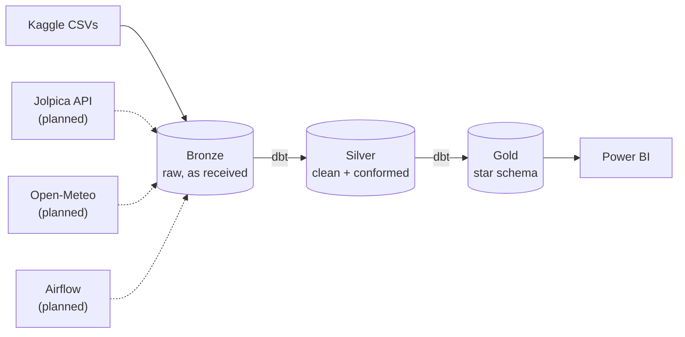

# f1-strategy-analytics
End-to-end F1 race strategy analytics: Python ingestion, Postgres medallion warehouse, dbt transformations, Airflow orchestration, Power BI dashboard

# F1 Strategy Analytics

> A production-style data pipeline that turns 70+ years of Formula 1 data into race strategy insights, built with open-source tools (Power BI for the final dashboard).

**Status:** In progress. Version 1 is intentionally simple (Kaggle CSVs, Postgres, dbt, Power BI). More sources and automation are added in later phases (see the [Roadmap](#roadmap)).

---

## Table of Contents

1. [Project Overview](#project-overview)
2. [Business Questions](#business-questions)
3. [Architecture](#architecture)
4. [Tech Stack](#tech-stack)
5. [Data Sources](#data-sources)
6. [Data Model](#data-model)
7. [Transformation Techniques](#transformation-techniques)
8. [Data Quality](#data-quality)
9. [Repository Structure](#repository-structure)
10. [Getting Started](#getting-started)
11. [Dashboard](#dashboard)
12. [Roadmap](#roadmap)
13. [F1 Glossary](#f1-glossary)
14. [Project Management](#project-management)
15. [License and Credits](#license-and-credits)

---

## Project Overview

**The scenario:** A (fictional) race strategy team has decades of race data spread across files. The head of strategy needs one trusted source to decide **when to pit, how many stops to plan, and how much starting position matters**.

**What this project does:**

- Loads historical Formula 1 data into a PostgreSQL warehouse
- Cleans, conforms and models it with dbt using a **medallion architecture** (Bronze, Silver, Gold)
- Tests the data automatically
- Serves a star schema to a Power BI dashboard

**Who it is for:**

| Persona | Uses |
|---|---|
| Head of strategy | Executive summary page |
| Race analyst | Driver, constructor and strategy drill-downs |
| Data engineer (me) | Data quality and lineage documentation |

---

## Business Questions

The Gold layer and the dashboard are designed to answer these:

1. Does pit-stop timing affect positions gained? (2011 onward, when pit-stop data exists)
2. What is the average time lost in the pits at each circuit?
3. How does grid position translate into win probability?
4. Are 1-, 2- or 3-stop strategies more successful, by circuit and era?
5. What causes DNFs, by constructor and era?
6. Who wins the teammate battle in qualifying and in the race?
7. How has constructor dominance shifted across regulation eras?
8. Does weather change pit-stop behavior or DNF rates? *(needs weather data, added in a later phase)*

---

## Architecture



Solid lines are version 1. Dashed lines are planned.

| Layer | Purpose | Built by | Allowed transformations |
|---|---|---|---|
| **Bronze** | Immutable copy of the source plus audit columns (`_loaded_at`, `_source_file`, `_batch_id`) | Python | None |
| **Silver** | Trusted, conformed, row-level data | dbt | Cleansing, type casting, standardization, integration, derived columns, row-level business rules |
| **Gold** | Business-ready star schema | dbt | Aggregations, KPI logic, slowly changing dimensions |

Postgres schemas: `bronze`, `silver`, `gold`, and `meta` (pipeline bookkeeping, added later).

Power BI reads from **Gold only**.

---

## Tech Stack

| Layer | Tool | Cost |
|---|---|---|
| Ingestion | Python (pandas, SQLAlchemy) | Free, open source |
| Warehouse | PostgreSQL 16 (Docker) | Free, open source |
| Transformation | dbt-core + dbt-postgres | Free, open source |
| Containers | Docker Compose | Free for personal use |
| Version control | Git + GitHub | Free |
| DB browsing | DBeaver Community | Free, open source |
| Dashboard | Power BI Desktop | Free to build; Windows only; not open source |
| Planned | Airflow, GitHub Actions, Great Expectations or dbt tests | Free, open source |

> **Note:** Power BI Desktop runs on Windows only and publishing/sharing online needs a paid license. For portfolio purposes this repo includes screenshots, a demo video and the `.pbix` file.

---

## Data Sources

| Source | What it provides | Load type | Phase |
|---|---|---|---|
| [Kaggle: Formula 1 World Championship (1950-2020)](https://www.kaggle.com/datasets/rohanrao/formula-1-world-championship-1950-2020) | About 14 CSV tables: drivers, constructors, circuits, races, results, qualifying, lap times, pit stops, status | Full | 1 |
| Jolpica-F1 API | Same structure, kept current (recent races) | Incremental | 2 |
| Open-Meteo | Weather by circuit coordinates and race date | Incremental | 3 |
| FastF1 | Tyre compounds and stints (2018+) | Incremental | 3 |
| Wikipedia | Circuit facts such as length and number of turns | One-off scrape | 3 |

**Known data limits:** lap times start in 1996 and pit stops in 2011, so strategy analysis focuses on 2011 onward.

---

## Data Model

Star schema in the `gold` schema (version 1):

**Dimensions:** `dim_driver`, `dim_constructor`, `dim_circuit`, `dim_race`

**Facts:** `fct_race_results`, `fct_pit_stops`

**Aggregates:** `agg_driver_season`, `agg_constructor_season`

Later phases add `fct_lap_times`, `agg_circuit_strategy` and slowly changing dimension history tables.

**Slowly changing dimensions**

| Type | Applied to |
|---|---|
| SCD 0 | Circuit coordinates and country, driver date of birth |
| SCD 1 | Spelling or nationality corrections (overwrite) |
| SCD 2 | Driver-to-team history with `valid_from`, `valid_to`, `is_current` *(Phase 3)* |
| SCD 3 | Team `current_name` and `previous_name` *(Phase 3)* |

---

## Transformation Techniques

Every technique from the ETL methods cheat sheet is implemented somewhere in the project:

| Technique | Example in this project | Phase |
|---|---|---|
| Remove duplicates | Keep the latest row per race and driver with `row_number()` | 1 |
| Handling missing data | `\N` to NULL; keep NULL for eliminated qualifying sessions and add flags like `reached_q3` | 1 |
| Handling invalid values | Quarantine non-positive lap times and implausible pit durations | 1 |
| Data type casting | Lap time text like `1:27.452` to integer milliseconds; text to dates | 1 |
| Handling unwanted spaces | `clean_text()` macro trims names and status text | 1 |
| Data filtering | Pit-stop analysis from 2011 onward | 1 |
| Data integration | Join results, races, circuits, drivers, constructors, status | 1 |
| Derived columns | `positions_gained`, `is_podium`, `is_dnf`, `lap_time_seconds` | 1 |
| Business rules and logic | Era-specific points systems, DNF categories, strategy labels (1-stop, 2-stop, 3+) | 1 |
| Data aggregations | Driver and constructor season summaries | 1 |
| Outlier detection | Flag (not delete) unusual lap times and pit durations using the IQR rule | 3 |
| Normalization and standardization | Constructor lineage mapping (for example Toro Rosso to AlphaTauri to RB), nationality-to-country mapping | 3 |
| Data enrichment | Weather, circuit facts, regulation era, driver age at race | 3 |

**Load methods used:** truncate and insert (Bronze full loads), drop/create/insert (reference tables and aggregates), append and upsert (API loads, Phase 2), merge (incremental fact tables, Phase 2).

---

## Data Quality

Tests run with `dbt test`:

- **Staging:** `unique` and `not_null` on primary keys, `accepted_values` on status fields
- **Relationships:** every result points to a real driver, race and constructor
- **Business rules:** finishing positions are unique per race; pit-stop durations fall in a plausible range
- **Reconciliation:** Gold row counts match Silver

Issues found in the source data are logged in [`docs/data_quality_log.md`](docs/data_quality_log.md).

---

## Repository Structure

```
f1-strategy-analytics/
├── docker-compose.yml          # PostgreSQL container
├── .env.example                # connection settings (copy to .env)
├── requirements.txt
├── README.md
├── data/
│   └── raw/                    # downloaded Kaggle CSVs (git-ignored)
├── ingestion/
│   └── load_kaggle_to_bronze.py
├── warehouse/
│   └── ddl/
│       └── 01_create_schemas.sql
├── dbt_project/
│   ├── dbt_project.yml
│   ├── profiles.yml            # reads credentials from environment variables
│   ├── macros/                 # clean_text, lap_time_to_ms, schema naming
│   ├── models/
│   │   ├── silver/
│   │   │   ├── staging/        # 1:1 with Bronze, cleansing and casting
│   │   │   └── intermediate/   # integration, derived columns, business rules
│   │   └── gold/
│   │       ├── dimensions/
│   │       ├── facts/
│   │       └── aggregates/
│   ├── seeds/                  # points systems and other reference data
│   └── tests/
├── powerbi/
│   └── f1_strategy.pbix
└── docs/
    ├── architecture.png
    ├── data_dictionary.md
    ├── data_quality_log.md
    └── images/                 # dashboard screenshots
```

---

## Getting Started

### Prerequisites

| Tool | Notes |
|---|---|
| Git | Clone the repo |
| Python 3.11 or 3.12 | Ingestion scripts and dbt |
| Docker Desktop | Runs PostgreSQL |
| DBeaver (optional) | Browse the database |
| Power BI Desktop | Windows only, for the dashboard |

8 GB RAM is enough for version 1.

### 1. Clone and set up Python

```bash
git clone https://github.com/<your-username>/f1-strategy-analytics.git
cd f1-strategy-analytics

python -m venv .venv
source .venv/bin/activate        # Windows: .venv\Scripts\activate
pip install -r requirements.txt
```

### 2. Configure environment

```bash
cp .env.example .env             # Windows: copy .env.example .env
```

Default values in `.env.example`:

```
POSTGRES_USER=f1
POSTGRES_PASSWORD=change_me
POSTGRES_DB=f1_warehouse
POSTGRES_HOST=localhost
POSTGRES_PORT=5432
```

Never commit `.env`.

### 3. Start PostgreSQL

```bash
docker compose up -d
```

Then create the schemas:

```bash
docker exec -i <postgres-container-name> psql -U f1 -d f1_warehouse < warehouse/ddl/01_create_schemas.sql
```

If port 5432 is already in use, change the left side of the port mapping in `docker-compose.yml` (for example `5433:5432`) and update `POSTGRES_PORT`.

### 4. Download the data

1. Download the [Kaggle dataset](https://www.kaggle.com/datasets/rohanrao/formula-1-world-championship-1950-2020) (a free Kaggle login is required).
2. Unzip the CSV files into `data/raw/`.

### 5. Load Bronze

```bash
python ingestion/load_kaggle_to_bronze.py
```

Each CSV loads into the `bronze` schema unchanged, with audit columns added. Check the row counts in DBeaver against the CSV files.

### 6. Run dbt (Silver and Gold)

```bash
cd dbt_project
export DBT_PROFILES_DIR=.        # Windows PowerShell: $env:DBT_PROFILES_DIR="."
dbt seed
dbt run
dbt test
dbt docs generate && dbt docs serve
```

A macro overrides dbt's default schema naming so models land in `silver` and `gold` rather than prefixed schemas.

### 7. Connect Power BI

1. Open Power BI Desktop, then **Get Data**, then **PostgreSQL database**.
2. Server `localhost:5432`, database `f1_warehouse`.
3. Select tables from the **`gold`** schema only.
4. In Model view, confirm the star-schema relationships.

If Power BI asks for the Npgsql driver, install it. If you are not on Windows, run Power BI in a Windows VM or export the Gold tables to CSV.

---

## Dashboard

Four pages:

| Page | Content |
|---|---|
| **Season Overview** | Standings progression, wins by team, season filters |
| **Driver and Constructor Deep Dive** | Slicers by driver, team and era; teammate comparison |
| **Race Strategy** | Pit-stop timing vs positions gained, stops per race, win rate by grid position |
| **Data Quality and Methodology** | Test results, row counts, last refresh, data limitations |

Screenshots: *(add to `docs/images/` and link here)*

Demo video: *(add link)*

---

## Roadmap

### Phase 1: Simple end-to-end (current)
- [ ] Repo, `.gitignore`, project board
- [ ] Docker Postgres and schemas
- [ ] Load Kaggle CSVs into Bronze
- [ ] dbt staging models with cleansing (Silver)
- [ ] dbt intermediate models: integration, derived columns, business rules
- [ ] Gold star schema and aggregates
- [ ] dbt tests
- [ ] Power BI dashboard v1
- [ ] Data dictionary and data quality log

### Phase 2: Incremental loading
- [ ] Jolpica API loader for new races
- [ ] Watermark table (`meta.load_watermark`) and pipeline run log
- [ ] Upsert and append patterns, incremental dbt models (merge)

### Phase 3: Enrichment and advanced modeling
- [ ] Open-Meteo weather, Wikipedia circuit facts, FastF1 tyre stints
- [ ] Outlier detection, constructor lineage, enrichment models
- [ ] SCD 2 and SCD 3 dimensions

### Phase 4: Automation
- [ ] Airflow DAG (extract, load, `dbt run`, `dbt test`)
- [ ] GitHub Actions running `dbt test` on every push
- [ ] Failure alerts

### Phase 5: Stretch
- [ ] Simulated source database and database-query extraction
- [ ] Event streaming of lap events (Redpanda)
- [ ] CDC with Debezium

---

## F1 Glossary

| Term | Meaning |
|---|---|
| Grand Prix | A single race of the season |
| Constructor | A team (Ferrari, Mercedes, and so on) |
| Grid position | Starting position, decided by qualifying |
| Pole position | First place on the grid |
| Pit stop | Car enters the pit lane for new tyres; the whole pit-lane trip costs roughly 20 seconds |
| Stint | Laps between two pit stops |
| Tyre compounds | Soft (fast, wears quickly), medium, hard (slower, lasts longer) |
| Undercut | Pitting earlier than a rival to gain track position |
| Safety car | Slows the field after an incident; pitting under it is cheaper |
| DNF | Did not finish |
| Positions gained | Grid position minus finishing position |

---

## Project Management

- Work is tracked on a GitHub Projects board (Backlog, Ready, In Progress, In Review, Done).
- One branch per issue; changes merge through pull requests.
- Definition of done: code merged, tests passing, documented, and safe to re-run.

---

## License and Credits

Released under the [MIT License](LICENSE).

**Data credits**
- Historical data: Kaggle "Formula 1 World Championship (1950-2020)" dataset, derived from the Ergast database
- API data (planned): [Jolpica-F1](https://github.com/jolpica/jolpica-f1), the community successor to Ergast
- Weather (planned): Open-Meteo

This is an independent portfolio project and is not affiliated with or endorsed by Formula 1 or any team.

**Author:** *Your Name* | [LinkedIn](#) | [GitHub](#)
